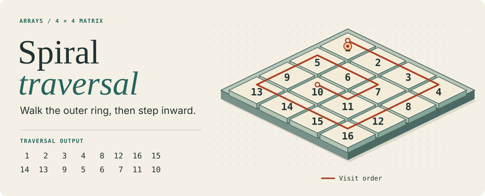
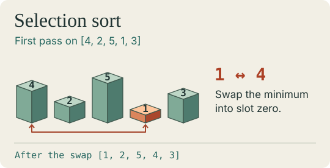
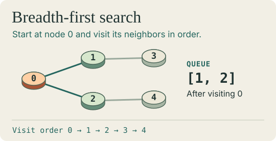

# DSA

My C++ practice notebook. I add the problems I solve to [Daily LeetCode](Daily%20leetcode/) and keep implementations I want to revisit in the topic folders below.

<a href="Array/Medium/spiralmatrixtraversal.cpp">
  <picture>
    <source media="(max-width: 600px) and (prefers-reduced-motion: reduce)" srcset="docs/visuals/spiral-mobile-still.svg">
    <source media="(prefers-reduced-motion: reduce)" srcset="docs/visuals/spiral-still.svg">
    <source media="(max-width: 600px)" srcset="docs/visuals/spiral-mobile.svg">
    
  </picture>
</a>

[Read the spiral traversal in C++](Array/Medium/spiralmatrixtraversal.cpp). Each pass moves the top, right, bottom, and left boundaries inward. Every cell gets one visit.

## Two more dry runs

## Browse by topic

| Looking for | Open |
| --- | --- |
| Array problems | [Easy](Array/Easy/) · [Medium](Array/Medium/) · [Hard](Array/Hard/) |
| Search and ordering | [Binary search](BinmarySearch/) · [Sorting](Sorting/) |
| Strings and windows | [Strings](string/) · [Sliding window](slidingWindow/) |
| Traversal | [Graphs](graph/) · [Recursion](recursion/) |
| C++ practice | [Basics](Basics/) · [STL](STL/) · [Bit manipulation](bit%20manipulation/) · [Patterns](Patterns/) · [Threading](Threading/) |
