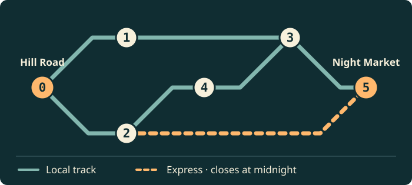

# Last train home

The courier reaches Hill Road with a parcel for the night market. She can take her bicycle on the train. Every track runs both ways, and each hop takes one minute.

1. At 11:59 p.m., all tracks are open for the whole trip. What's her quickest route from **0** to **5**?
2. If she starts after midnight, the express between **2** and **5** has closed. Which way should she go, and how much time does she lose?

Unfold the timetable

**Before midnight** she takes **0 → 2 → 5**. That's two minutes. There's no direct track from 0 to 5, so she can't do it in one.

**After midnight** she takes **0 → 1 → 3 → 5**. Three minutes, one extra. Going through station 2 still works, but **0 → 2 → 4 → 3 → 5** takes four.

Here's how to see the second answer with breadth-first search. After one minute she can be at **1 or 2**. After two, the newly reachable stations are **3 and 4**. Station **5** first appears in the third layer.

[Read my C++ BFS traversal](../graph/bfs.cpp) · [Back to the notebook](../README.md)
